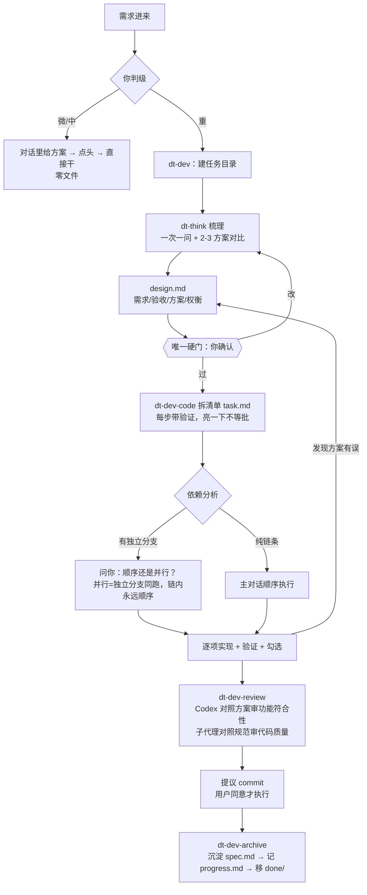

# dt-workflow

> **English**: A lightweight AI development workflow, packaged as an agent-skill family. Logic lives in 6 user-level skills; each project only carries a few plain-markdown files under `.dt/` (specs, progress, task archives). One hard gate (design confirmation), zero CLI dependency, zero hooks, zero per-session token tax. Install once via `npx skills add Daotin/dt-workflow -g`, then say "用 dt-dev 做 XX" in any project. Docs below are in Chinese.

一套**轻量 AI 开发工作流**：逻辑装在 6 个用户级 skill 里，每个项目只留 `.dt/` 下几个 markdown 文件（规范、进展、任务档案）。装一次，所有项目直接用。

## 为什么轻

市面上的 AI 开发工作流框架（Trellis、各类 spec-driven 脚手架）通常要求：装 CLI、每个项目 init 一套脚本和配置、用 hook 在每次会话 / 每条消息里注入流程规则。这些强制力是为早期弱模型设计的护栏——模型能力上来之后，护栏本身变成了摩擦。

dt-workflow 反着来：

- **无 CLI 依赖**：不用 `npm install` 任何运行时，流程就是 skill 里的文字
- **无 hook、无注入税**：不在每次会话 / 每条消息里塞流程提醒，上下文零常驻成本
- **无每项目 init**：第一次在某项目里使用时，skill 自动创建 `.dt/` 目录，完事
- **每项目脚印 ≈ 4 个 markdown**：`spec.md`、`progress.md`、每任务一个目录（对比框架类工具的上百个文件）
- **逻辑集中一处**：改进 skill，所有项目立即生效，不存在"每个项目挨个 update"

## 核心理念：按任务分级，绝大多数任务零流程

流程只服务真正需要建档的任务。分级判断在**你**，不在 AI——你比任何判级逻辑更清楚这个需求有多大：

| 档位 | 例子 | 做法 |
|---|---|---|
| 微 | 修小 bug、改文案 | 说一句就改，看 diff，零文件 |
| 中 | 动几个文件，一次会话干得完 | 方案发对话里，你点头，直接干，零文件 |
| 重 | 跨会话 / 方案有分量 / 步骤多 | 显式说"用 dt-dev 做"，走完整流程建档 |

中途升档随时可以：干着干着变大了，说一声"建档"，对话里已确认的内容整理进任务目录接着走。

## 安装

```bash
npx skills add Daotin/dt-workflow -g
```

`-g` 装到用户级，所有项目可用（[skills CLI](https://www.npmjs.com/package/skills) 会自动铺到 Claude Code、Codex、Cursor 等各工具的 skill 目录）。装到单个项目则去掉 `-g`。

## 30 秒上手

在任意项目里对 AI 说：

```
用 dt-dev 做：给设置页加一个导出功能
```

AI 会：首次使用自动创建 `.dt/` → 一问一答梳理需求 → 写方案文档 design.md → **等你确认（唯一硬门）** → 拆执行清单逐项实现（有并行空间时问你要不要派子代理并行）→ Review（功能符合性交给 Codex 审，代码质量由子代理审；没装 Codex 时都由子代理审）→ 提议 commit（同意才执行）→ 归档沉淀。

各阶段也可单独进入：

| 说法 | 效果 |
|---|---|
| `用 dt-think 帮我理一下思路` | 只做头脑风暴 + 出方案文档 |
| `用 dt-dev-code 继续` | 方案已确认，直接编码（也用于跨会话续做） |
| `用 dt-dev-review 检查一下` | 只做代码 Review |
| `用 dt-dev-archive 归档` | 只做经验沉淀 + 归档 |
| `用 dt-tech-doc 写方案` | 只写技术文档（独立可用） |

## `.dt/` 目录结构

```
.dt/                          # 建议加入 .gitignore（skill 初始化时自动处理）
  spec.md                     # 项目规范六节：架构决策 / 开发规范 / 复用模式 / 坑 / 业务规则 / Review 必查
  progress.md                 # 进展流水，归档时追加
  tasks/
    260726-export-feature/    # 一个重任务一个目录（YYMMDD-slug）
      design.md               # 需求 + 验收标准 + 调研 + 方案（含权衡）——确认门审这个
      task.md                 # 执行清单（每步带验证）+ 状态——确认后才创建
    done/                     # 完成的任务目录整体移入
```

设计原则：**规范与记忆分层**——`progress.md` 是原始流水（只在续做时读），`spec.md` 是提炼结果（每次开工都读，保持精炼）；归档动作是两者之间的提炼管道。个人写作偏好存于 `~/.dt/learned-rules.md`（用户主目录），随反馈生长，永不进项目仓库。

## 完整流程



执行中的两条铁律：

- **不漂移**：代码与 design.md 必须始终对得上——小偏差顺手更新方案说一声，方向性偏差停下来重新确认
- **给路径不给转述**：派子代理时让它自己读 design.md / task.md / spec.md 相关节，不靠主对话转述

## FAQ

**和 Trellis 这类工作流框架有什么区别？**
它们把逻辑（工作流规则、hook 脚本、任务管理 CLI）复制进每个项目，靠 hook 每条消息注入流程规则来获得强制力；dt-workflow 把逻辑放在用户级 skill、项目里只放数据，靠"你显式调用"获得确定性。代价是没有 hook 级的 100% 强制力，收益是零常驻开销、零项目侵入——对现在的模型能力，这笔交换是划算的。

**支持哪些 AI 工具？**
skill 格式是 [agent skills 生态](https://github.com/vercel-labs/skills)的通用格式，`npx skills add` 会自动安装到 Claude Code、Codex、Cursor、Gemini CLI 等工具。`.dt/` 里全是纯 markdown，任何工具都能读——数据层永远可移植。

**可以只装部分 skill 吗？**
可以。依赖关系：dt-dev 调 dt-think，dt-think 调 dt-tech-doc（未装时自动降级为按同结构直接生成），dt-dev-code 收尾调 dt-dev-review / dt-dev-archive。单独用 dt-think 或 dt-tech-doc 完全独立。

**`~/.dt/learned-rules.md` 是什么？**
dt-tech-doc 的个性化插槽：你对生成文档的反馈会提炼成个人规则存在这里（用户主目录，不进任何仓库），后续生成优先遵守。不存在时自动跳过。

**怎么卸载？**
`npx skills remove` 按提示选择，或直接删除各工具 skill 目录下的 6 个 `dt-*`。项目里的 `.dt/` 是你的数据，留不留随你。

## License

[MIT](./LICENSE)
